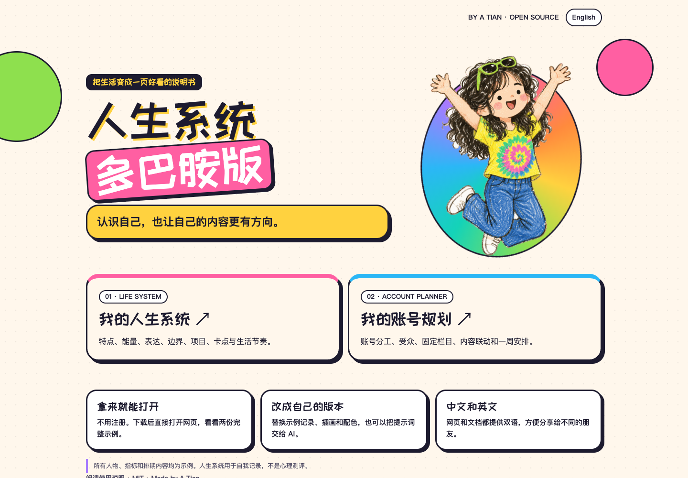
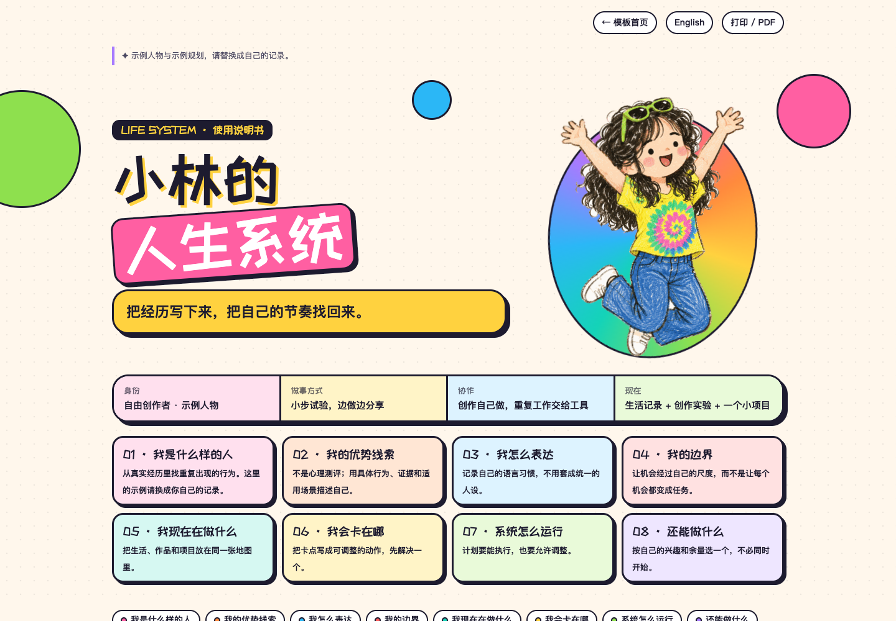
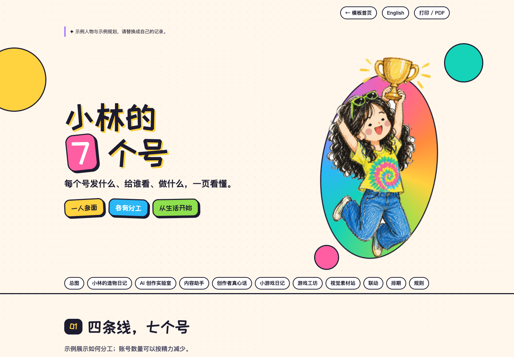
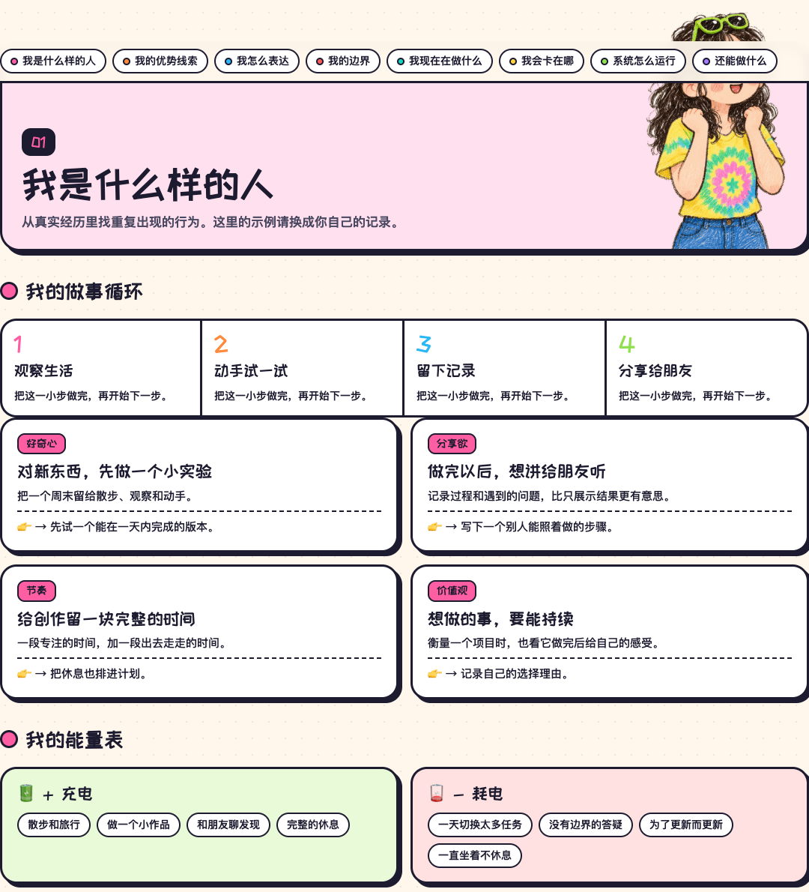
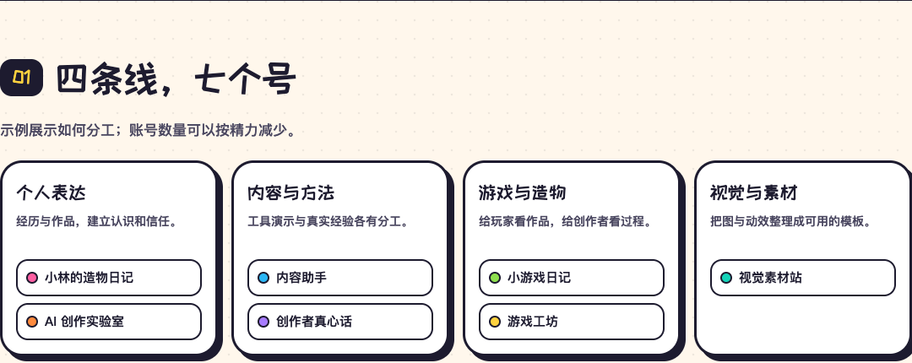
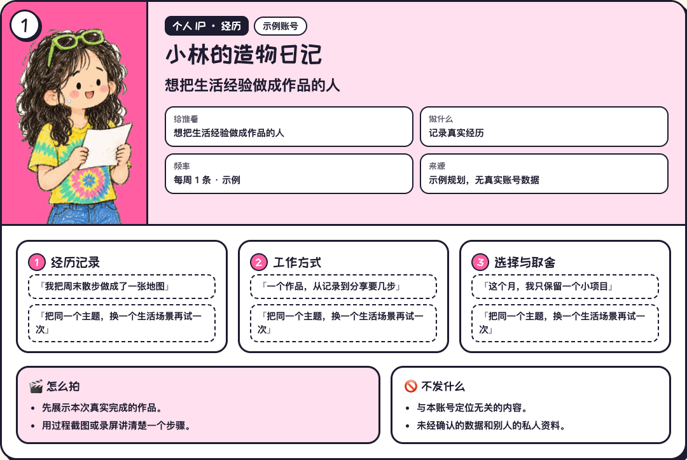
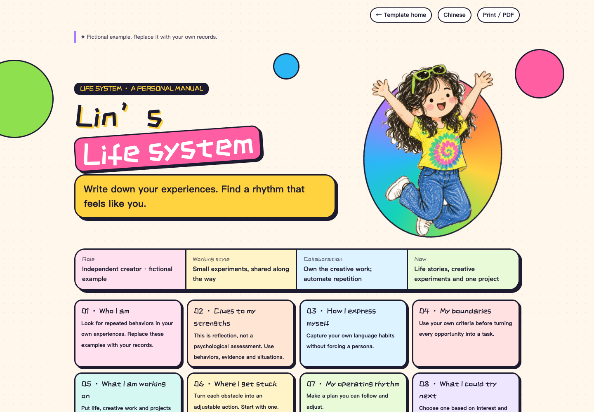
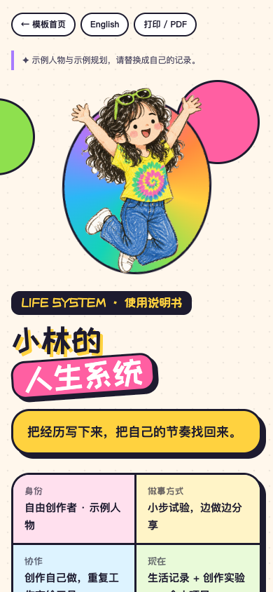
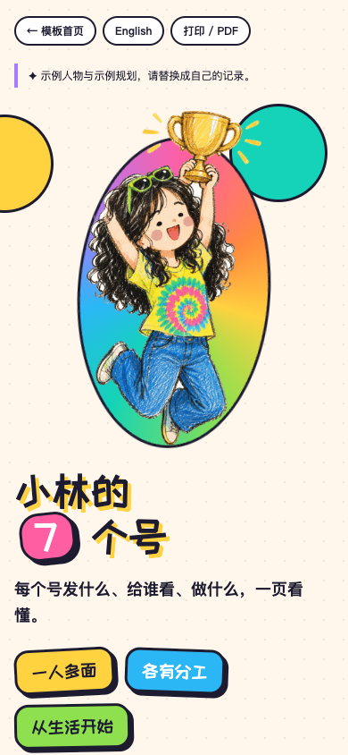

<div align="center">

# 多巴胺人生系统

### 把人生系统和账号规划，做成一页想分享给朋友的网页。

**多巴胺配色 · 粗描边 · 贴纸卡片 · 生活与创作规划**

[中文](README.md) · [English](README_EN.md) · [如何改成自己的](docs/CUSTOMIZE.md) · [提示词](prompts/README.md)



由阿甜提供的「人生系统」「7 个账号规划」网页发展而来的两套可复用模板。

保留彩色卡片、卡通形象和清晰的分区，把内容换成公开示例，让你也能做自己的版本。

</div>

## 两套模板

| 人生系统 | 账号规划 |
| --- | --- |
|  |  |
| 特点、能量、优势线索、表达、边界、项目、卡点、运行节奏 | 账号分工、受众、定位、栏目、联动、周排期、发布边界 |
| [中文页面](templates/life-system.html) · [English page](templates/life-system.en.html) | [中文页面](templates/account-planner.html) · [English page](templates/account-planner.en.html) |

以上链接在 GitHub 中显示源文件。下载后打开 `index.html` 即可浏览网页；配置 GitHub Pages 后可在线查看。

## 有什么特别

- **严肃的规划也能有趣。** 奶油色点阵背景、彩虹色块、粗线条和硬阴影，让长内容像一张生活地图。
- **保留自己的样子。** 人生系统围绕真实经历、能量与边界展开，不要求把自己套进统一的人设。
- **账号各有分工。** 四条内容线、七个示例账号，每个账号都有受众、栏目、制作方式与不发的内容。
- **中文、英文都能分享。** 两套网页和 README 均提供完整的中英文版本；导航可直接切换。
- **打开就能看，改完就能用。** 无运行依赖、无登录、无后台。生成好的 HTML 可直接打开，也可静态托管。
- **附带复制即用的提示词。** 把自己的资料和视觉要求交给 AI，沿着同一套结构生成新版本。

## 再看几个细节





<details>
<summary>账号卡片、英文页面和手机版截图</summary>








</details>

## 怎么开始

1. 下载仓库 ZIP 并解压。
2. 打开 `index.html`，选择「人生系统」或「账号规划」。英文入口是 `index_en.html`。
3. 直接修改 HTML，或把 [提示词](prompts/README.md) 和示例网页交给 AI，替换为自己的内容。
4. 想按结构化数据维护时，修改 `data/` 中的 JSON，再运行：

```sh
python3 scripts/build.py
```

可选本地预览：

```sh
python3 -m http.server 8000
```

然后访问 `http://localhost:8000`。也可在浏览器里使用「打印 / PDF」。

## 你需要准备什么

| 人生系统 | 账号规划 |
| --- | --- |
| 简单介绍、真实经历、经常说的话、能量来源、边界、正在做的项目、生活节奏 | 账号名、给谁看、做什么、固定栏目、示例选题、制作方式、更新频率和分工 |

没有数据就留空，不要为了填满模板编造履历、收入、粉丝或心理特征。这里的人物「小林」、项目、栏目和排期都是演示内容；未包含原稿里的账号报价、合作独家和未公开产品计划。

## 设计风格

可以用这组词描述：**多巴胺配色 + Neo-brutalism（新粗野主义）的粗描边与硬阴影 + 卡通贴纸式编辑排版**。

这是视觉特征的组合，不是一个必须严格遵循的流派。具体配色和布局见 [设计说明](docs/DESIGN.md)。

## 项目结构

```text
├── index.html / index_en.html          # 双语入口
├── templates/                         # 两套模板，各有中英文版
├── data/                              # 可编辑的双语示例内容
├── assets/                            # 样式与示例插画
├── prompts/                           # 人生系统、账号规划、视觉风格提示词
├── scripts/build.py                   # Python 标准库静态生成器
└── docs/                              # 定制说明、设计说明、真实截图
```

页面使用 Google Fonts 的站酷快乐体；断网时自动使用系统字体。图片和 CSS 随仓库提供。页面不采集个人数据，不请求 AI 接口，也不会自动分析你的资料。

## 部署与贡献

GitHub Pages：在 **Settings → Pages → Deploy from a branch** 选择 `main` 和 `/ (root)`。其他静态托管服务也可直接使用。

欢迎改进手机版布局、打印效果、翻译、模板结构或无障碍体验。修改示例内容后请重新生成页面，保持 `data/` 与 `templates/` 一致。

代码、模板和本仓库随附的示例资源按 [MIT License](LICENSE) 开源。制作自己的个人介绍时，建议换成自己的形象与名字。
